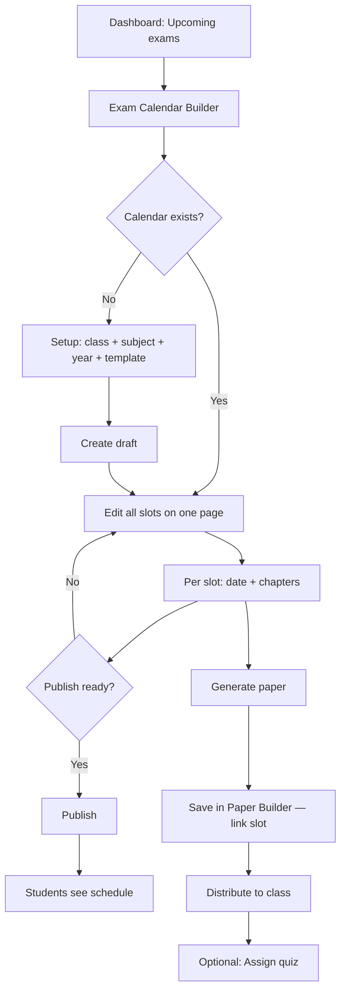
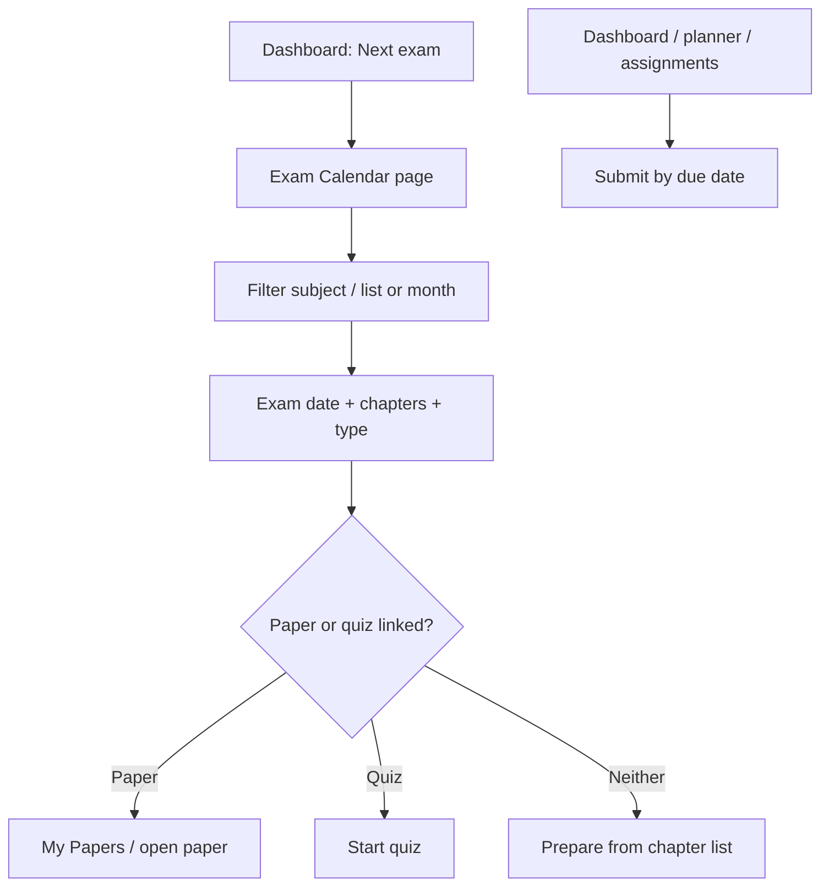

# Exam Calendar — Product Plan

**Status:** Living document (MVP built; polish and nav clarity in progress)  
**Last updated:** June 2026  
**Routes:** Teacher `/teacher/exam-calendar` · Student `/student/exam-calendar`

This document defines what the **Academic Exam Calendar** is, how it differs from **due-date / workload** views, and how **teacher** and **student** dashboards should integrate with it.

---

## 1. Two calendars (do not merge conceptually)

| | **Academic exam calendar** | **Due-date / workload calendar** |
|--|---------------------------|----------------------------------|
| **Purpose** | Plan the **school year**: unit tests, half-yearly, final — with **NCERT chapters** per exam | Track **what students must submit**: quiz attempts, paper distributions |
| **Created by** | Teacher: one plan per **class + subject + academic year** | System: from **published assignments** and **paper distributions** |
| **Student sees** | “15 Aug: Unit Test 1 — Crop Production, Microorganisms…” | “Submit Quiz X by Friday”, “Paper Y due today” |
| **Primary routes** | `/teacher/exam-calendar`, `/student/exam-calendar` | Teacher: assignments list (tab label “Due dates” today) · Student: planner / dashboard tasks |

**Rule:** Exam calendar = **curriculum planning**. Assignments = **execution and grading**. Same exam date can align with quiz/paper due dates, but they are different data sources.

---

## 2. Current implementation snapshot

### Teacher — built

| Capability | Status |
|------------|--------|
| Create draft (class, subject, year, template: 6-exam / 5-UT / custom) | Done |
| Single-page slot editor (date, marks, duration, drag reorder) | Done |
| Add chapters (modal + NCERT search; titles from `chapter_names.json`) | Done |
| Auto-save draft | Done |
| Publish / unpublish / duplicate draft | Done |
| Strict overlap (settings gear → block publish) | Done |
| Slot workflow: Planned → Paper → Distributed → Quiz → Done | Done |
| Generate paper → Paper Builder → auto-link slot | Done |
| Distribute paper modal | Done |
| Assign quiz modal (`due_at` = exam date) | Done |
| Dashboard: **Upcoming exams** widget | Done |
| APIs: copy calendar, iCal export | Built; UI hidden for MVP |
| Month view on builder | Component exists; hidden for MVP |

### Student — built

| Capability | Status |
|------------|--------|
| Read **published** calendars (multi-subject) | Done |
| List + month view, subject filter, print | Done |
| Dashboard: **Next exam** card | Done |
| Paper linked indicator | Partial (“Paper assigned”) |

### Known gaps

- Teacher tab **“Due dates”** links to **Assignments**, not a calendar grid — label overpromises.
- Student **`/student/calendar`** is a placeholder; real data is on **`/student/exam-calendar`**.
- Teacher **`/teacher/calendar`** redirects to exam builder (legacy bookmarks).
- No unified student page for **exam plan + assignment due dates** together.
- Head-of-school template (one plan → many classes): not built.
- Parent PDF / iCal: API exists; teacher UI deferred.

---

## 3. Mental model (one line per role)

- **Teacher:** “I publish a **year plan** per subject; for each exam I set **chapters**, then **paper**, then optionally **quiz**.”
- **Student:** “I see **when exams are** and **what syllabus** is tested; separately I see **what I must submit** before deadlines.”

---

## 4. Teacher flow (end-to-end)



### Per-slot operational loop

| Step | Status chip | Teacher action |
|------|-------------|----------------|
| 1 | **Planned** | Set date + add chapters |
| 2 | **Paper ready** | Generate / edit linked paper |
| 3 | **Distributed** | Distribute paper to class |
| 4 | **Quiz assigned** | Assign quiz (optional) |
| 5 | **Done** | Exam date passed |

Publish validation (draft): at least one slot; every slot has **date** and **≥1 chapter**; optional **strict overlap** blocks publish if the same chapter appears in multiple exams.

---

## 5. Student flow (end-to-end)



**Note:** Exam **date** is informational unless teacher distributes paper or assigns quiz (defaults often use exam date as due date).

---

## 6. Teacher dashboard — integration plan

### Role of the dashboard

The dashboard is **summary + deep links**, not a second builder. Full editing stays on **Exam Calendar Builder**.

### Blocks (target layout)

```
┌─ Teacher dashboard (class-scoped) ─────────────────────────────┐
│ KPIs: papers to grade, weak students, quizzes…  (unchanged)   │
├────────────────────────────────────────────────────────────────┤
│ UPCOMING EXAMS                                    [View calendar →] │
│  • UT1 · Science · 15 Jul · Planned                          │
│  • Half yearly · Science · 20 Sep · Paper ready                │
│  (max 3 rows from published calendars for selected class)      │
├────────────────────────────────────────────────────────────────┤
│ Assignments / papers / review  (operational — separate)        │
└────────────────────────────────────────────────────────────────┘
```

### Widget: **Upcoming exams** (implemented)

| Field | Source | Notes |
|-------|--------|-------|
| Data | `GET /api/teacher/exam-calendars/upcoming?class_id=` | Published slots only, sorted by date |
| Limit | 3 slots | Avoid clutter |
| Empty state | CTA “Build calendar →” | Links to `/teacher/exam-calendar` |
| Class scope | `teacherClassStore` / dashboard `class_id` | Must match builder class selector |

### Recommended enhancements (Phase B)

| Enhancement | Why |
|-------------|-----|
| Show **status chip** per row (Planned / Paper ready / …) | Teacher sees readiness without opening builder |
| Deep link `?slot_id=` from dashboard row | Scroll/highlight slot in builder |
| One-line **action hint** | e.g. “Paper not distributed” for next exam |

### What not to put on the dashboard

- Full slot editor, chapter picker, publish controls  
- Syllabus coverage % when zero chapters  
- iCal / copy calendar (defer to builder ⋯ menu)

### Nav (teacher)

| Nav item | Route | Subtitle / tab |
|----------|-------|----------------|
| **Exam Calendar** (Tools) | `/teacher/exam-calendar` | Tab **Exam plan** (builder) |
| **Due dates** (tab on page) | `/teacher/assignments` today | **Rename** to “Assignments” OR add real due-date calendar page |
| Legacy `/teacher/calendar` | Redirect → exam builder | Keep for bookmarks |

---

## 7. Student dashboard — integration plan

### Role of the dashboard

Surface **next academic exam** only (published). Homework and deadlines stay in **assignments / planner**, not mixed into the exam card.

### Blocks (target layout)

```
┌─ Student dashboard ────────────────────────────────────────────┐
│ Greeting + class / streak / exam_message (existing)            │
├────────────────────────────────────────────────────────────────┤
│ NEXT EXAM (card)                              [Exam calendar →] │
│  Unit Test 1 · Science · 15 Aug                              │
│  Crop Production, Microorganisms…                              │
│  Paper assigned (if linked)                                    │
├────────────────────────────────────────────────────────────────┤
│ Due soon / assignments / planner  (separate — homework layer)   │
└────────────────────────────────────────────────────────────────┘
```

### Widget: **Next exam** (implemented)

| Field | Source | Notes |
|-------|--------|-------|
| Data | `GET /api/student/exam-calendar` | All published calendars for student’s class |
| Selection | Nearest **future** slot (by exam date) across subjects | Hidden if none |
| Link | `/student/exam-calendar` | Full schedule |
| Chapters | First 2 labels + “+N” | Truncated summary |

### Recommended enhancements (Phase B)

| Enhancement | Why |
|-------------|-----|
| **Start quiz** / **Open paper** on card when linked | Closes loop without extra navigation |
| Subject badge when multiple calendars | Clear which subject is “next” |

### What not to put on the dashboard

- Draft or unpublished teacher plans  
- Full year list (that’s the Exam Calendar page)  
- Assignment due dates inside the same card (split widgets)

### Nav (student)

| Nav item | Route | Action |
|----------|-------|--------|
| **Exam Calendar** (Progress) | `/student/exam-calendar` | Canonical exam plan page |
| **`/student/calendar`** | Stub today | **Redirect** to exam-calendar OR merge tabs: **Exam plan \| Due dates** |

---

## 8. Exam Calendar pages (full experience)

### Teacher — `/teacher/exam-calendar`

| Section | Purpose |
|---------|---------|
| Tabs | **Exam plan** (builder) · **Assignments** (due work — rename tab) |
| Calendar setup | Class, subject, year, template (locked after create) |
| Exam schedule | All slots; Add chapter modal; paper / distribute / quiz |
| Sticky footer | Publish readiness banner · Save draft · Publish |
| Settings (gear) | Strict chapter overlap |

**MVP UI choices (intentional):** No iCal/Copy in header; no List/Month toggle on builder; syllabus % only when chapters mapped; drag handle on hover only.

### Student — `/student/exam-calendar`

| Section | Purpose |
|---------|---------|
| List / month toggle | Year-at-a-glance |
| Subject filter | Multi-subject timelines |
| Print | Printable schedule |
| Slot cards | Date, type, chapters, paper/quiz hints |

---

## 9. Data model (reference)

| Entity | Scope |
|--------|--------|
| `exam_calendars` | `class_id` + `subject` + `academic_year`; status `draft` \| `published` |
| `exam_calendar_slots` | Ordered exams: type, title, date, marks, duration, links |
| `exam_calendar_slot_chapters` | NCERT chapter keys + labels + pdf URLs |
| Links | `linked_paper_id`, `linked_assignment_id` on slot |

One **published** calendar per (class, subject, year) enforced at publish time.

---

## 10. Roadmap

### Phase A — MVP stable (current)

- [x] Teacher builder single-page + publish
- [x] Chapter modal with real titles (`chapter_names.json`)
- [x] Paper + distribute + quiz loop
- [x] Student read + dashboard next exam
- [x] Teacher dashboard upcoming exams
- [ ] Nav cleanup (student calendar stub, rename Due dates tab)
- [ ] Document English-medium default for chapter list

### Phase B — Dashboard + loop polish

- [ ] Teacher upcoming row: status chip + deep link to slot
- [ ] Student next exam: CTA for linked paper/quiz
- [ ] Optional notification: “Exam in 7 days”

### Phase C — Planning UX

- [ ] Teacher month view (re-enable)
- [ ] iCal + copy calendar (⋯ menu)
- [ ] Syllabus coverage analytics (when `used > 0` only in UI)

### Phase D — School scale

- [ ] Head template → copy to multiple classes
- [ ] Per-subject calendars unchanged (Science ≠ Maths)

### Phase E — Unified student timeline (optional)

- [ ] One page: **Exam plan** + **Due this week**
- [ ] Parent printable annual schedule (PDF)

---

## 11. API quick reference

| Endpoint | Role |
|----------|------|
| `POST /api/teacher/exam-calendars` | Create draft |
| `GET /api/teacher/exam-calendars` | List by class/subject/year |
| `PUT .../slots` | Save slots + chapters |
| `POST .../publish` | Publish (`strict_overlap` query) |
| `POST .../unpublish` | Back to draft |
| `POST .../duplicate` | Copy as new draft |
| `PATCH .../slots/{id}/link-paper` | After Paper Builder save |
| `PATCH .../slots/{id}/link-assignment` | After quiz create |
| `GET /api/teacher/exam-calendars/upcoming` | Dashboard widget |
| `GET /api/student/exam-calendar` | Student schedule |

---

## 12. Related files

| Area | Path |
|------|------|
| Teacher builder | `web/components/lms/teacher/ExamCalendarBuilder.tsx` |
| Chapter picker | `web/components/lms/teacher/ExamCalendarChapterPickerModal.tsx` |
| Teacher upcoming widget | `web/components/lms/teacher/TeacherUpcomingExams.tsx` |
| Student next exam widget | `web/components/lms/student/StudentNextExamCard.tsx` |
| Chapter list helper | `web/lib/examCalendarBulkChapters.ts` |
| Slot status | `web/lib/examCalendarSlotStatus.ts` |
| Paper deep link | `web/lib/examCalendarPaperLink.ts` |
| Backend router | `src/lms/routers/teacher_exam_calendar.py` |
| Services | `src/lms/services/exam_calendar.py`, `exam_calendar_templates.py` |

---

## 13. Decisions log

| Decision | Rationale |
|----------|-----------|
| Per class + per subject + per year | Matches how schools plan (Science teacher owns Science calendar) |
| Default 6-exam template | UT1→UT2→Half→UT3→UT4→Final |
| Publish = student-visible | Drafts never leak to students |
| Dashboard = summary only | Reduces clutter; builder is workbench |
| Hide iCal/Copy in MVP | Low teacher usage until plan is stable |
| English NCERT list in chapter modal | Matches primary paper builder; Hindi toggle later |

---

*For implementation tracking across the wider LMS, see `docs/LMS_IMPLEMENTATION_TRACKER.md` and `docs/AITUTOR_LMS_PLAN.md` where exam calendar phases are referenced.*
